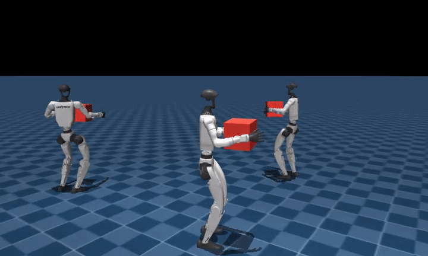

# unitree-g1-humanoid-carry

> **Walk-while-carrying for the Unitree G1 with rigid, sloshing, and soft payloads.** Proximal Policy Optimisation (PPO) fine-tune that starts from an actor already trained on the pick task, tracking a twist command while keeping a box stable at chest height. Three payload variants exercise distinct disturbance profiles (rigid, free-floating balls, tendon-linked lattice).

[](LICENSE)
[](https://www.python.org/downloads/release/python-3100/)
[](https://github.com/google-deepmind/mujoco)
[](https://github.com/mujocolab/mjlab)
[](https://github.com/leggedrobotics/rsl_rl)
[](src/policy_carry_slosh.py)

<p align="center">
  
</p>
<p align="center"><sub>Four parallel rollouts of the trained carry policy tracking twist commands while keeping a rigid box stable at chest height.</sub></p>

## Overview

Walk-while-carrying stage of the loco-manipulation chain. The policy follows a `(vx, vy, wz)` body-frame twist command while keeping a payload stable at chest height. Three variants share the same MDP, only the payload body differs, and all three reset from the pick terminal-state buffer, so training starts from a distribution of already-grasped states.

Key properties:
- **Three payload variants, one MDP.** Reward, actions, observations are shared across rigid / slosh / soft.
- **Body-yaw-framed box observations.** `box_pos`, `box_orientation`, hand-to-box, trunk-to-box are rotated into the robot's body-yaw frame, so sagittal mirror augmentation produces physically consistent (obs, action) pairs at any base yaw.
- **Warm-starts from pick, not walk.** Reset event samples pick-terminal states; the policy inherits a grasped-box prior.
- **Mirror sanity suite is a first-class citizen.** `view_mirror.py` + `verify_mirror.py` + `ablation_mirror.py` catch sign/permutation bugs before a 6-hour training run.

Scope boundaries: single-box transport only. Placing the box on a target surface is the sibling [`place`](../unitree-g1-humanoid-place) task.

## Prerequisites

- **Python 3.10 exactly**.
- **CUDA GPU.** Smoke run fits ~5 GB VRAM; full training ~4 to 6 h per variant on a NVIDIA B300 SXM6.
- **[uv](https://github.com/astral-sh/uv)** for pinned installs.
- **Pick terminal buffer** required at reset time (`outputs/pick_terminal_states.npz`). Produced by the sibling [`pick`](../unitree-g1-humanoid-pick) repo.
- **Headless MuJoCo:** `MUJOCO_GL=egl`.

## Quickstart (~5 min on a laptop GPU)

```bash
git clone https://github.com/narayanerm/unitree-g1-humanoid-carry.git
cd unitree-g1-humanoid-carry
uv pip install -r requirements.txt
jupyter lab 02a_carry_normal.ipynb
```

Set `DEBUG_LIGHT = True` (64 envs x 3 PPO iterations) and Run All. Expect: a checkpoint under `outputs/logs/g1_carry/<timestamp>/`, TensorBoard scalars climbing on `Episode/rew_track_lin_vel_xy` and `Episode/rew_hold_box`, and `docs/frame_map.png` not yet written (comes from the full run).

## Full training

Pick a variant and leave `DEBUG_LIGHT = False`:

| Notebook                   | Task ID                   | Payload                                 |
| -------------------------- | ------------------------- | --------------------------------------- |
| `02a_carry_normal.ipynb`   | `Mjlab-G1-Carry`          | Rigid box, fixed mass.                  |
| `02b_carry_slosh.ipynb`    | `Mjlab-G1-Carry-Slosh`    | Hollow box + N balls, DR on total mass. |
| `02c_carry_soft.ipynb`     | `Mjlab-G1-Carry-Soft`     | Tendon-linked lattice.                  |

Notebook flags: `REUSE_TRAINING`, `RESUME`, `WARM_START_FROM_PICK`, `DEBUG_LIGHT`.

**Slosh gotcha:** call `policy_carry_slosh.configure(num_balls=..., ball_radius_m=...)` **before** `register()`. Post-`register()` reconfiguration is silently ignored.

### Validate the mirror augmentation before a long run

Three bundled tools stress-test `src/symmetry.py` numerically and visually:

```bash
# Visual: two envs side-by-side, env 1 is the sagittal mirror of env 0.
python view_mirror.py

# Numerical: 5 independent tests (obs/action involution, state-to-obs
# consistency, 15-reward invariance, mirror on 200 real rollout obs).
python verify_mirror.py

# Practical: 500-iter ablation with vs without mirror aug, same seed.
python ablation_mirror.py
```

## Using the trained policy

**Load a checkpoint and run inference:**

```python
import torch
from src.policy_carry import register, g1_carry_env_cfg

register()
env_cfg = g1_carry_env_cfg(play=True)
state = torch.load("outputs/logs/g1_carry/<ts>/model_<N>.pt", map_location="cuda")
# state["model_state_dict"] holds the actor-critic weights.
# Build the env (see src/train_loop.py for the full wrapper) and run the actor.
```

**Inspect training curves:**

```bash
tensorboard --logdir outputs/logs/g1_carry*
```

**Record a video of the latest checkpoint** (requires GPU for mjlab):

```bash
# Via the record-videos skill (private) or:
MUJOCO_GL=egl python scripts/make_portfolio_media.py outputs/media/<carry_rollout>.mp4
# writes docs/demo.gif + docs/frame_map.png
```

## Repo layout

```
src/
  policy_carry.py         Normal (rigid) carry. Shared constants (BOX_HALF, BOX_HOLD_Z, G1_JOINTS). TASK_ID = "Mjlab-G1-Carry".
  policy_carry_slosh.py   Hollow box + balls. Imports from policy_carry, rebuilds scene with alpha walls. DR on total mass.
  policy_carry_soft.py    Tendon-linked lattice payload.
  policy_walk.py          Kept locally for buffer generation of walk states used elsewhere.
  symmetry.py             Body-yaw-frame mirror (sign table + CARRY_OBS_LAYOUT).
  train_loop.py, collect_buffer.py, utils.py, tiers.py   Shared infra.
02a_carry_normal.ipynb, 02b_carry_slosh.ipynb, 02c_carry_soft.ipynb   Entry points.
view_mirror.py, verify_mirror.py, ablation_mirror.py   Mirror sanity suite.
outputs/
  logs/g1_carry*/            Checkpoints + TB events (kept).
  pick_terminal_states.npz   Reset buffer input (kept).
```

## Technology stack

| Component            | Choice                                                                                   |
| -------------------- | ---------------------------------------------------------------------------------------- |
| Physics simulator    | MuJoCo Warp (GPU-parallel) via **mjlab**                                                 |
| RL algorithm         | PPO (`rsl_rl`), adaptive LR, GAE(λ=0.95), clip=0.2                                       |
| Policy architecture  | 3-layer MLP (512-256-128, ELU), observation normalisation                                |
| Observation          | 124 D (base state + 29 D q+dq + last a + twist cmd + 7 box terms)                        |
| Action               | 29 D joint position targets                                                              |
| Transfer learning    | Pick warm-start + progressive layer unfreeze                                             |
| Reset event          | Sample from pick terminal buffer (yaw-aligned body frame)                                |
| Data augmentation    | Sagittal-plane mirror in **body-yaw frame** ([src/symmetry.py](src/symmetry.py))         |
| Domain randomisation | Total payload mass (slosh), friction, encoder bias, base COM                             |
| Compute target       | 1x NVIDIA B300 SXM6 (tuned); scalable via `src/tiers.py`                                 |

## Design decisions

- **Three variants, one MDP.** `policy_carry_slosh.py` and `policy_carry_soft.py` import constants from `policy_carry.py` and only swap the payload body. Reward, actions, observations are shared.
- **Body-yaw mirror.** Box observations are stored in the robot's body-yaw frame so a left/right mirror is a plain sign flip on y plus joint swap, independent of world yaw. See `CARRY_OBS_LAYOUT` and the sign table in [`src/symmetry.py`](src/symmetry.py).
- **Shared snapshot schema.** The pick repo's `collect_buffer` writes states yaw-aligned; `reset_from_pick_buffer` here re-anchors with a fresh sampled yaw. Robot and box stay coherent through the resample.
- **Mirror sanity suite catches bugs before training.** Reward-invariance is tested across 15 independent reward terms, so a hidden self-consistent bug in `src/symmetry.py` would still trip at least one of them.

## Troubleshooting

| Symptom                                            | Likely cause / fix                                                                                      |
| -------------------------------------------------- | ------------------------------------------------------------------------------------------------------- |
| Slosh training ignores `num_balls`                 | `configure(...)` was called after `register()`. Reorder the two calls.                                  |
| Mirror aug fires sign-flip assertion               | `CARRY_OBS_LAYOUT` drifted from the actor obs dict. Verify with `python verify_mirror.py` before training. |
| Pick terminal buffer missing                       | Train pick first and copy `outputs/pick_terminal_states.npz` into this repo's `outputs/`.               |
| Box pops out of the hands mid-episode              | Grip-preservation weight too low; check reward term weights in the active notebook.                     |
| OOM on slosh                                       | Balls add many contact pairs; lower `NUM_ENVS` in `src/tiers.py` or reduce `num_balls`.                 |

## Pipeline position

Downstream of pick; often paired with place to complete a pick-and-place loop.

```
PICK  -->  pick_terminal_states.npz  (warm-start)
             |
             v
         CARRY (here, 3 variants)  -->  place or FSM demo
```

| Repo | Role |
| --- | --- |
| [walk](../unitree-g1-humanoid-walk) | Base locomotion |
| [reach](../unitree-g1-humanoid-reach) | Standing bimanual reach |
| [pick](../unitree-g1-humanoid-pick) | Walk to table + grasp (warm-start source) |
| **[carry](.)** ← you are here | Walk while carrying (rigid / slosh / soft) |
| [place](../unitree-g1-humanoid-place) | Set the carried box down |
| [fsm](../unitree-g1-humanoid-fsm) | Chain experts into a unified BC dataset |
| [monolithic-policy](../unitree-g1-humanoid-monolithic-policy) | Single MLP end-to-end alternative |

## Citation

```bibtex
@misc{medeiros2026g1carry,
  author       = {Ribeiro Medeiros, Narayane},
  title        = {unitree-g1-humanoid-carry: walk-while-carrying for the Unitree G1 with rigid, slosh, and soft payloads},
  year         = {2026},
  howpublished = {\url{https://github.com/narayanerm/unitree-g1-humanoid-carry}}
}
```

## Author & License

**Narayane Ribeiro Medeiros**, Instituto Tecnológico de Aeronáutica.
[GitHub](https://github.com/narayanerm) | [LinkedIn](https://www.linkedin.com/in/narayanerm) | narayane.rm@gmail.com

Released under the [MIT License](LICENSE).
